# TrustDeploy — Implementation Progress Log

This document records every significant step of the TrustDeploy implementation, with a screenshot taken immediately after each step. All screenshots come from a single clean run of scripts/run_all.sh on 2026-10-20 (local macOS, no cloud resources). Each one shows the exact command executed, its real output, its exit code and the capture time.

## Test results summary

| Test | Condition | Expected | Observed | Result |
|---|---|---|---|---|
| TC01 | Correctly signed image | Accepted | ACCEPT — SIGNATURE_VERIFIED | PASS |
| TC02 | Unsigned image | Rejected | REJECT — NO_SIGNATURE | PASS |
| TC03 | Signed with untrusted key | Rejected | REJECT — UNTRUSTED_SIGNER | PASS |
| TC04 | Signature does not match image (copied signature / tag hijack) | Rejected | REJECT — SIGNATURE_IMAGE_MISMATCH / NO_SIGNATURE | PASS |
| TC05 | Tool error / registry down / registry not allowed | Deployment denied | REJECT — VERIFICATION_TOOL_ERROR / IMAGE_RESOLUTION_FAILED / REGISTRY_NOT_ALLOWED | PASS |
| TC06 | Multiple images checked | Each recorded separately | 4 images → 4 audit entries | PASS |
| TC07 | Audit report generated | Displayed / exported | HTML + CSV + JSON written | PASS |

## Step-by-step log

### 1. Phase 1 — Environment setup

Docker, Cosign v3.1.3, Python, kind and kubectl are installed. A local OCI registry (registry:2) runs on localhost:5001, so no cloud resources are needed. The project tree separates the verifier, policy, audit and report components.

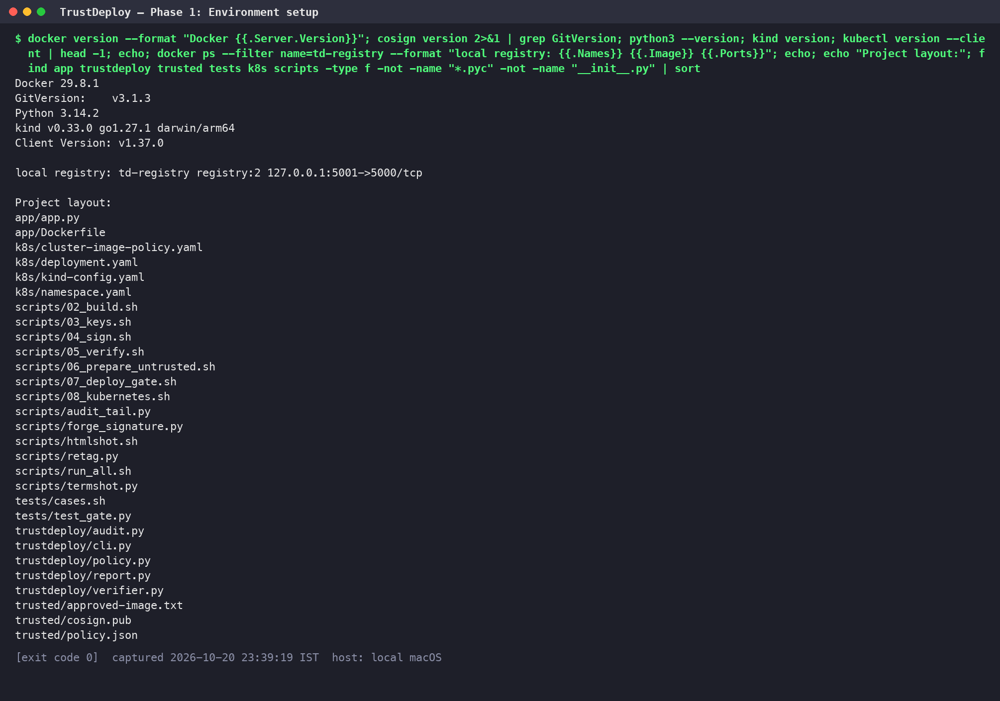

### 2. Phase 2 — Build the sample image and record its digest

The sample HTTP service is built and pushed with the versioned tag 1.0.0. The immutable manifest digest is recorded in trusted/approved-image.txt, and a smoke test confirms the container responds.

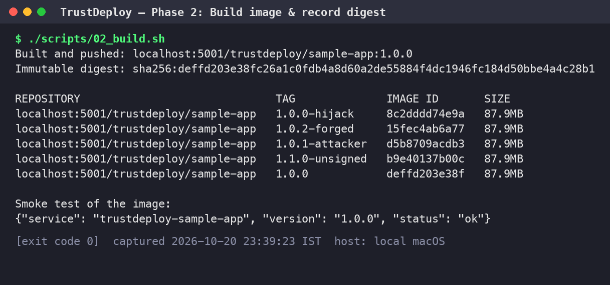

### 3. Phase 3a — Generate the trusted signing key pair

Cosign generates an encrypted ECDSA P-256 key pair in ~/.trustdeploy/keys (mode 600, outside the project). Only the public key is copied into trusted/cosign.pub. Checks confirm there is no *.key file in the project tree or inside the image.

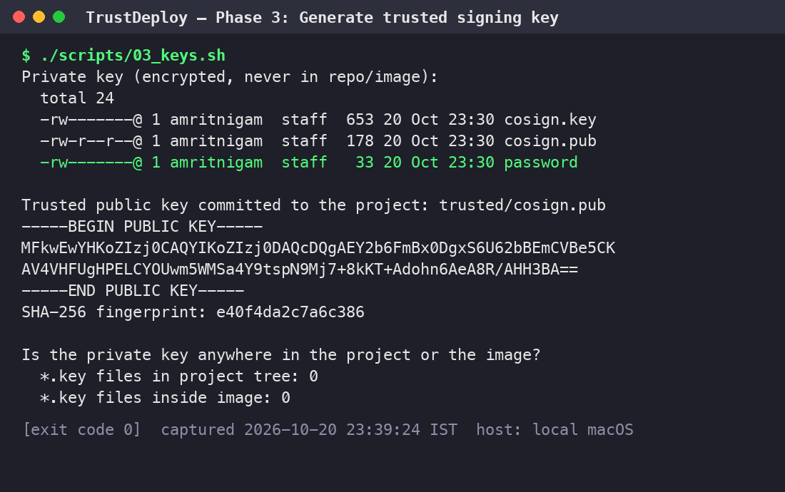

### 4. Phase 3b — Sign the approved image by digest

The approved image is signed by digest, never by tag. Two signatures are stored: the Sigstore bundle (OCI referrer) used by the TrustDeploy gate, and the legacy .sig format read by the Kubernetes Policy Controller. The transparency-log upload is disabled for this offline prototype.

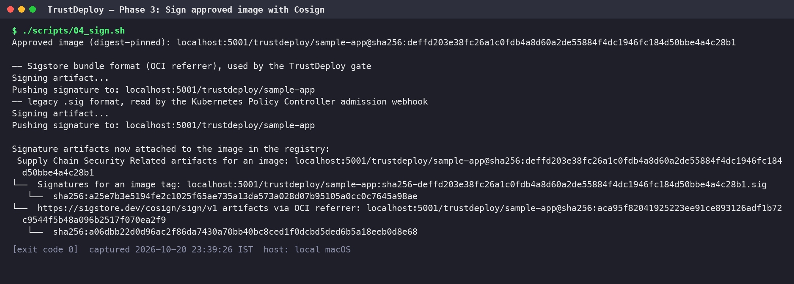

### 5. Phase 4 — Verify the trusted image (TC01)

cosign verify validates the signature against trusted/cosign.pub. The TrustDeploy gate receives the mutable tag :1.0.0, resolves it to the digest, verifies it, checks that the signed payload names that exact digest, and returns ACCEPT. Result: TC01 passed.

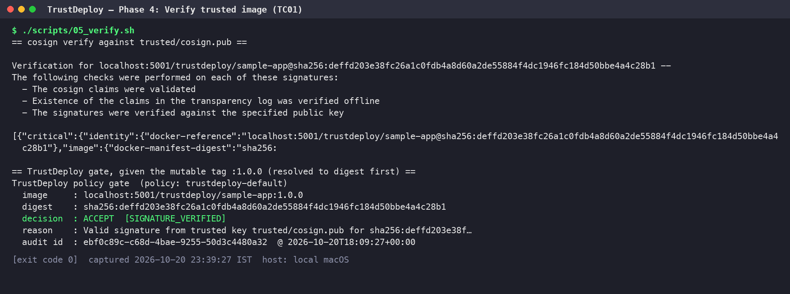

### 6. Phase 5 — Prepare untrusted / attack images

The negative tests use four images: an unsigned image; a backdoored image signed with an attacker's own key (a different fingerprint); an image carrying a genuine signature copied from 1.0.0 (scripts/forge_signature.py); and a tampered build used to hijack the :1.0.0 tag.

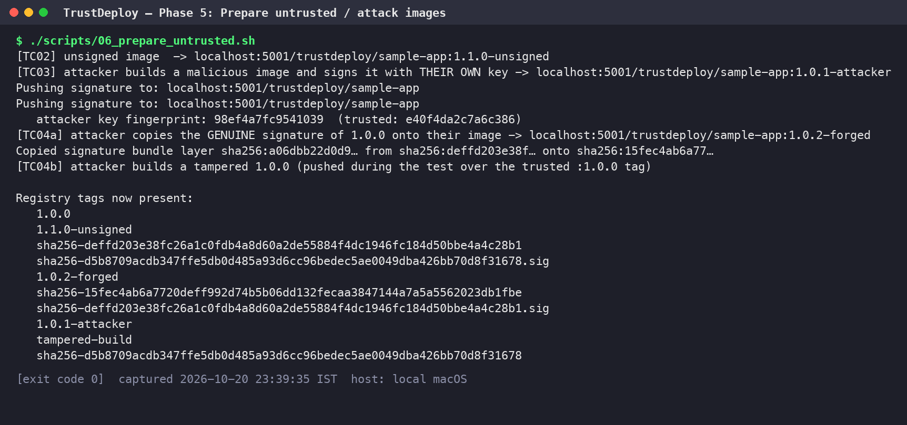

### 7. TC02 — Unsigned image

Rejected with NO_SIGNATURE. Result: TC02 passed.

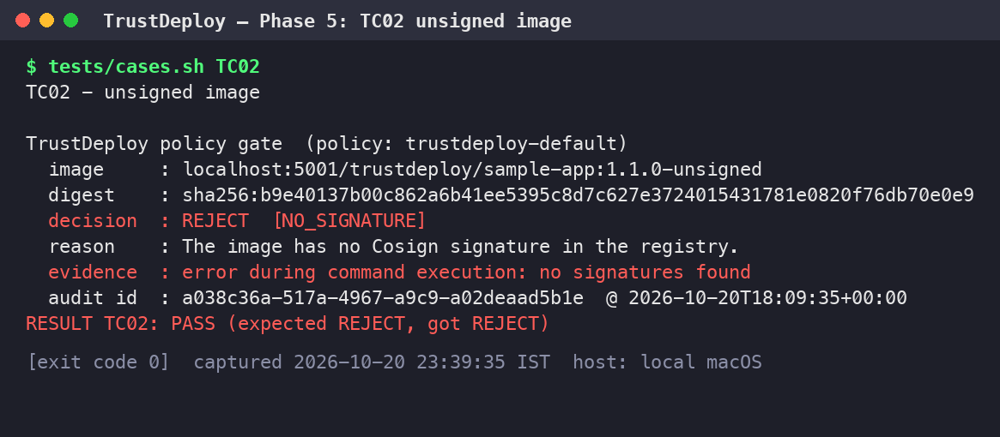

### 8. TC03 — Image signed with an untrusted key

A signature exists, but it does not validate against the trusted key, so the image is rejected with UNTRUSTED_SIGNER. Result: TC03 passed.

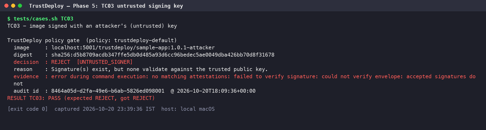

### 9. TC04a — Genuine signature attached to a different image

The copied signature is cryptographically valid, but its signed payload names a different digest, so the image is rejected with SIGNATURE_IMAGE_MISMATCH. Result: TC04 passed.

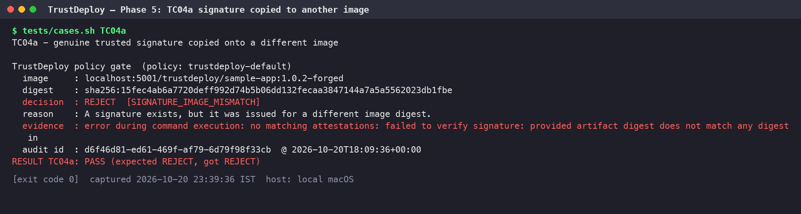

### 10. TC04b — Trusted tag overwritten with a tampered build

The attacker re-points :1.0.0 to a tampered build. The gate resolves the tag to the new digest, which carries no trusted signature, and rejects it. The tag is then restored.

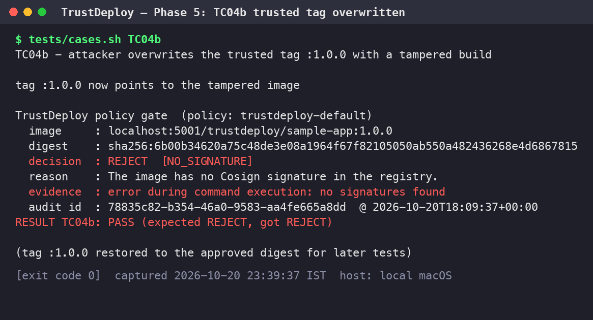

### 11. TC05a — Verification tool unavailable

Even for a validly signed image, a missing cosign binary results in VERIFICATION_TOOL_ERROR. The gate fails closed and deployment is blocked. Result: TC05 passed.

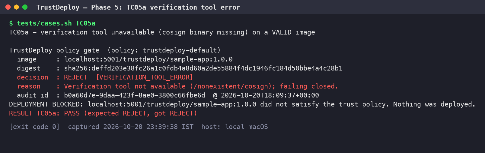

### 12. TC05b — Registry unreachable

With the registry stopped, the digest cannot be resolved, so the gate returns IMAGE_RESOLUTION_FAILED and blocks deployment.

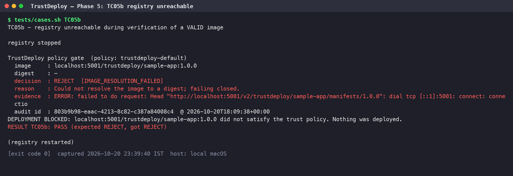

### 13. TC05c — Registry outside the allow-list

docker.io is not in policy.json's allowed_registries, so the gate rejects the image before contacting the registry.

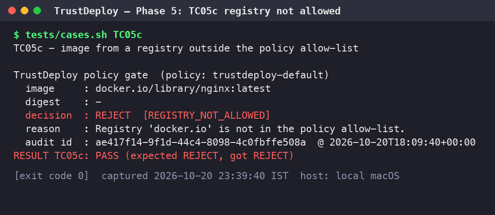

### 14. TC06 — Multiple images, separate audit records

Four images are checked in one batch, and four distinct audit entries are written, each with its own event ID, digest, decision and reason. Result: TC06 passed.

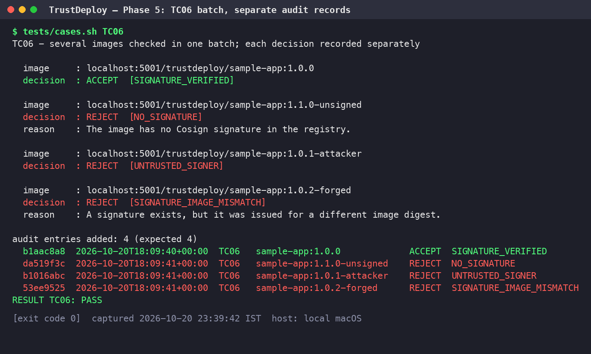

### 15. Unit tests — fail-closed logic

Eight unit tests, using a mocked cosign, cover acceptance, payload-digest mismatch, error classification, missing tool, timeout, unexpected exceptions, the registry allow-list, and the rule that the decision requires verified to be exactly True. All 8 passed.

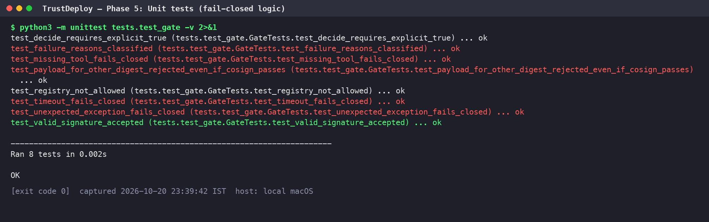

### 16. Phase 6 — Policy enforcement in the deploy workflow

trustdeploy deploy blocks the attacker-signed image (exit code 2, nothing started). It deploys the trusted image pinned to the verified digest, and the running container answers on port 18088.

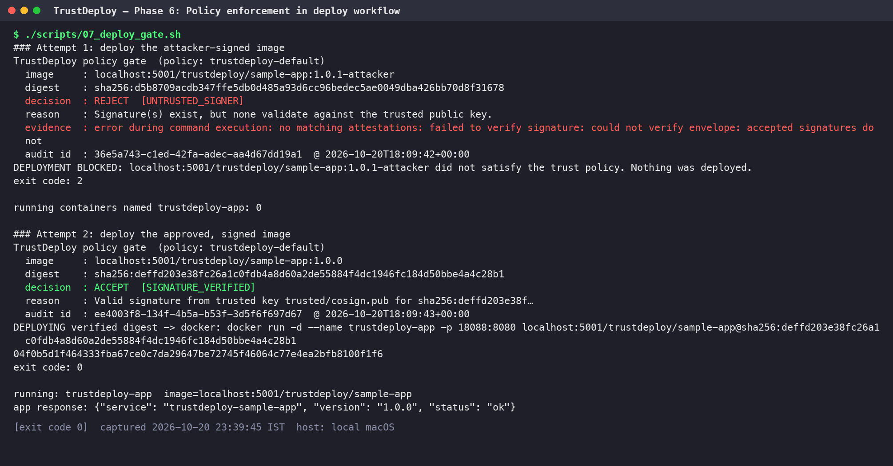

### 17. Phase 6 (K8s) — kind cluster + Sigstore Policy Controller

A local kind cluster runs policy-controller 0.13.1 (Helm chart 0.10.8). The ClusterImagePolicy trustdeploy-signed-images requires the TrustDeploy release key for td-registry.local:5000/**, and the trustdeploy namespace is opted in.

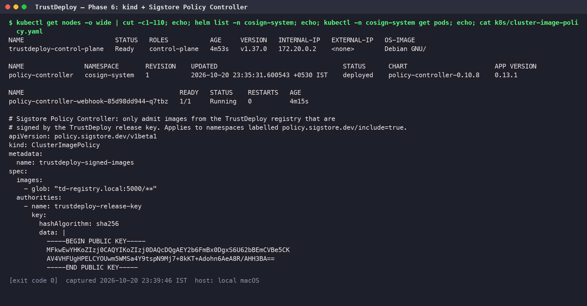

### 18. Phase 6 (K8s) — admission-time enforcement

The signed image is admitted and runs. The admission webhook denies the attacker-signed image ('invalid signature') and the unsigned image ('no signatures found'), so no pods are created for them.

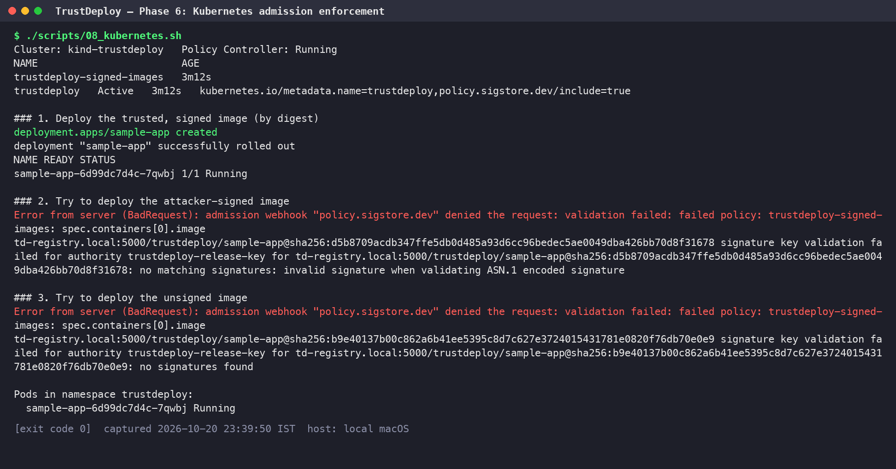

### 19. Phase 7 — TC07 audit report export

The audit log (JSONL) is exported to audit/report.html, report.csv and report.json. Each record holds the timestamp, image, digest, decision, reason code, policy, trusted-key fingerprint and a tool-evidence excerpt, and never any key material. Result: TC07 passed.

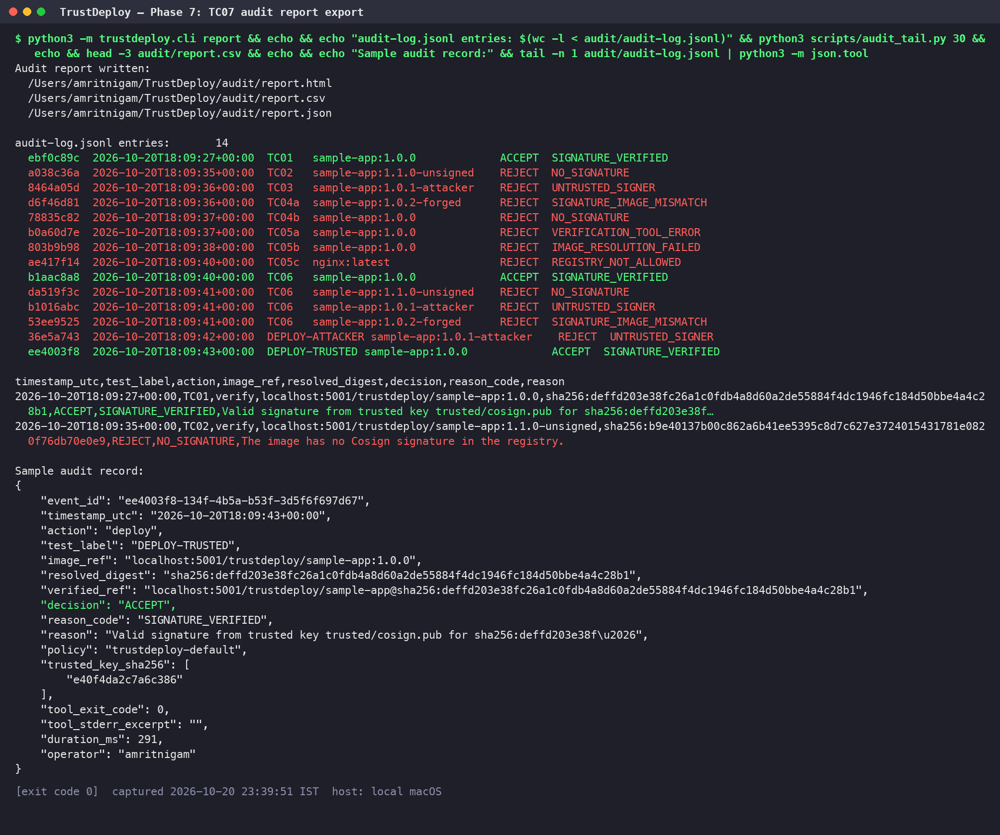

### 20. Phase 7 — Audit dashboard

The HTML dashboard summarises 14 verification events: 3 accepted and 11 rejected, broken down by reason, with per-event evidence.

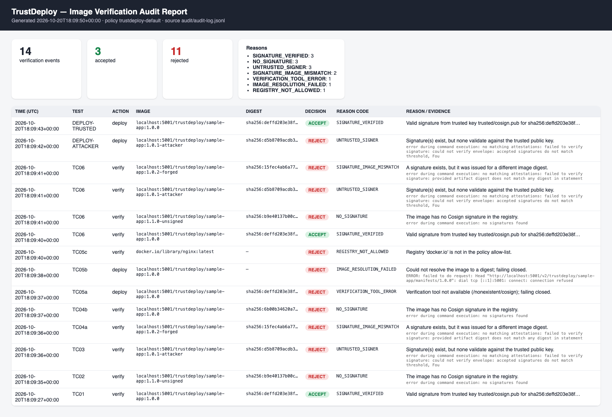

## Reproduce

```bash
cd ~/TrustDeploy && ./scripts/run_all.sh
```
